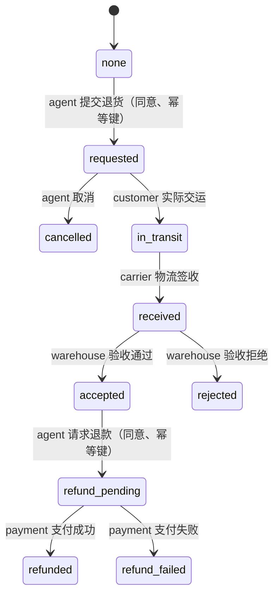

# 业务状态机与因果事件调度（v1）

状态：已实现，作为时间调度兼容协议保留。新世界使用 [无模拟时间的业务流程 v2](workflow-v2.md)。本文描述 v1；完整 v1 示例在 `examples/returns_lifecycle/`。

## 1. 解决的问题

初始条件、客户说法和实际业务事件不能混为一谈。刚发起退货时，商品应尚未交运；“用户说寄了”不会使仓库收到货。只有成功的业务迁移才能发出后续事件，后续事件再次检查前置状态。

退货例子：



物流签收和仓库验收分别建模。事件结果可以由题目的情景预先选择，但事件是否存在、何时发生，取决于实际已提交的前置动作。未申请不会排入交运事件；未交运不会排入签收事件。

## 2. 世界、题目、episode 的职责

| 层级 | 内容 | 不应承担的职责 |
|---|---|---|
| 世界生成 | 对象状态、合法迁移、角色、guard、effects、事件发射规则、不变量、参数范围、业务完成范围、独立验收用例 | 为某一道题写特殊流转规则 |
| 题目生成 | 用户诉求和同意、业务数据参数、情景参数、完成范围、合法历史 | 重写世界状态机，直接把初始行改成“已收到货” |
| episode 运行 | 私有业务数据库、当前时间、待处理事件、已处理事件 ID、幂等回执、迁移日志、同意令牌、对话 | 根据自然语言声明直接改业务状态 |
| verifier | 独立预期结果、实际迁移历史的业务校验 | 调用环境执行器计算标准答案 |

一个 episode 是独立运行实例，不要求独占 Docker。服务可以复用执行槽位；数据库、队列、日志、令牌和回执均由 episode 独立持有。同一个 episode 的 HTTP step/reward/fork 串行化，防止并发重试发生重复提交。

## 3. 文件与契约

`request.json` 用 `request_assets` 引用三个新增文件，并校验 SHA-256：

- `lifecycle_schema.json`：世界规格。`version=1`，`machines`、`transitions`、`tools`、`parameters`、`invariants`、`scopes`，可选 `max_events`。
- `scenario.json`：题目规格。`version=1`，`parameters`、`scope`、可选 `history`。只能选择世界声明的参数与范围，不能携带新迁移规则。
- `lifecycle_contract.json`：独立验收用例。`version=1`、`cases`；案例使用自有初始数据和情景，执行工具或等待并检查业务断言。

生成入口可设置领域配置 `lifecycle_required: true`，要求世界作者先完成状态机、样例情景和独立用例。调用方提供的同名字段会写入只读语义的 `lifecycle_inputs.json`，宿主检查内容未被修改。题目作者必须显式选择自己的 scenario，不能继承世界构建样例而不加区分。

原有 `data.json`、`facts.json`、`env.py`、`verifier.py`、`answer_schema.json` 继续使用。调用 `spec.write` 自动生成侧文件和哈希。新增运行时代码进入平台指纹，旧 bundle 需要经过原有 `verify` 重认证流程后在新平台运行。

### 状态机

每个 machine 声明 `table`、`field`、`states`、`initial`。一个受管表对应一个 machine，行 ID 必须唯一。v1 使用已有对象行；例如退货案例有一个预分配的 `none` 状态对象，申请时迁移到 `requested`。

迁移声明：

```json
{
  "machine": "return",
  "actor": "agent",
  "from": ["none"],
  "to": "requested",
  "guard": {"op": "gt", "args": [{"path": "row.amount"}, 0]},
  "effects": [],
  "emit": [{
    "transition": "handover",
    "entity": {"path": "entity"},
    "delay": {"path": "params.ship_delay"},
    "when": {"path": "params.will_ship"}
  }]
}
```

角色限于 `agent/customer/carrier/warehouse/payment/system`。学生工具只能绑定 agent 迁移；事件不能假冒 agent 执行需要同意的写操作。

`effects` 在已声明的受管表中更新已有行的业务字段，可以原子扣减共享库存等资源，但不能直接写 ID 或状态字段。状态字段只能由本次迁移的 `from/to` 改变。跨对象业务需要各自的显式迁移，不能通过 effect 将另一个对象跳到未来状态。

表达式沿用业务断言的安全数据表达式，无 `eval`、文件 I/O 或任意回调；上下文包括 `db/row/args/params/entity/now`。布尔组合支持 `all/any/not`，比较支持 `eq/ne/ge/le/gt/lt`，算术支持 `add/sub/mul` 等。受管表不允许普通生成工具直接修改。

### 工具绑定

```json
{
  "request_return": {
    "transition": "apply",
    "entity_arg": "return_id",
    "key_arg": "request_id"
  }
}
```

绑定工具保持正常的 `@write`、类型和业务文档。平台先执行迁移，工具函数再读取候选状态并生成回执；函数不得修改状态。前置条件必须在世界 guard 中表达，不能藏在回执函数里。未绑定的普通写工具仍可修改非受管表，但不能绕过状态机。

## 4. 一次业务写入怎么执行

1. 校验同意令牌或已有 plain-consent 规则。
2. 复制当前数据库与生命周期运行状态，形成一次事务候选。
3. 检查幂等键。相同键、相同迁移与参数返回原始回执；相同键、不同操作拒绝。
4. 校验角色、当前源状态和 guard。
5. 应用业务 effects 与目标状态，检查不变量。
6. 生成因果事件及审计记录，调用工具函数格式化回执。
7. 一次提交数据库、事件队列、迁移日志和幂等回执。

任何阶段失败，都不提交业务效果或事件。失败写入仍保留尝试日志；同意令牌沿用已有单次使用语义，重试需要新的同意令牌。幂等回执不会绕过同意检查。

## 5. 事件与时间

- 事件在父迁移提交时入队；ID 由父操作键和发射位置确定，不依赖执行槽位或机器时间。
- 队列按 `(到期逻辑时间, 事件 ID)` 排序。同一时刻的独立事件具有稳定顺序。
- `wait(seconds)` 推进逻辑时间，按事件的实际到期时间处理。等待 100 秒不会让所有中间事件都记成第 100 秒。
- 数字时间和 ISO 日历时间均支持。生命周期任务的 `tick=0`，聊天、查询本身不推进时间；零延迟事件也通过 `wait(0)` 或后续等待结算。
- 事件执行重新检查源状态及 guard。取消或资源变化导致不再适用时，记录 `event_cancelled`，不覆盖较新的状态，不自动无限重试。
- 调度器有 episode 级事件预算，默认 1000、上限 10000；超限或事件代码/规则故障使等待事务回滚，并报告环境错误。
- 最终回答结束 episode，不自动清空队列。`request_only` 可以合法停在待寄回；`full` 必须达到题目业务所要求的完成或失败范围。

当前外部动作采用确定性脚本：情景选择是否寄回、交运延迟、验收和支付结果；状态机决定何时能够发生。自然用户模拟器生成对话，聊天文本不会调用物流或支付迁移。这一版没有让用户 LLM 自行调用物流动作。

## 6. 合法初始阶段

基础表的受管行必须处于 machine.initial。需要“之前已经寄回”的题目，通过 `scenario.history` 构造：

```json
{
  "offset": -35,
  "transition": "apply",
  "entity": "R1",
  "args": {},
  "key": "previous-return"
}
```

offset 是相对题目开始时间的秒数，必须按时间排列且不大于 0。上述退货示例在第 -35 秒申请，第 -25 秒交运，第 -5 秒签收，第 +5 秒完成验收，因此题目开场为“已签收、待验收”。初始化会执行相同的状态机及事件规则，并保留未完成事件。

历史来自受信任题目规格，不是学生 API。历史中的 agent 动作代表过去已经发生的操作；本轮所有新写操作仍需同意。规格加载时就验证历史是否合法，题目不能用 `overlay` 跳过受管行的初始状态。

## 7. 验收与判分

新增强制 `lifecycle` 门禁：

- 独立用例必须包含等待、业务拒绝，并实际覆盖所有声明迁移；填写覆盖标签不算覆盖。
- 检查参考执行的真实历史，再伪造一个前置状态，确认独立 verifier 会拒绝。
- 原有差分、反例、HTTP 回放、业务断言、SOP 等门禁继续运行。

生命周期任务的独立 verifier 提供：

```python
def expected(data, facts, now, *, scenario):
    # 独立计算此题完成范围内的目标答案和数据库结果。
    ...

def verify_lifecycle(data, facts, now, result, *, scenario):
    # 按业务规则检查实际发生的历史，返回错误字符串列表。
    ...
```

`result.lifecycle` 包含队列、已处理 ID、回执、事件日志和规格哈希，业务工具和学生看不到。`verify_lifecycle` 根据业务规则独立验证因果顺序、角色、时间、前置状态与结果，不要求复制 reference 的查询顺序。

差分认证与实际 rollout 终局评分都会执行该检查。生命周期审计失败时，奖励为 0，即使最终字段和标准答案碰巧一致。原有成功条件还要求同意安全、答案及最终数据库均通过。

## 8. 隔离、回放和适用边界

- reset 深复制输入，重新构造历史和事件队列。
- fork 深复制当前数据库、时钟、队列、processed IDs、回执、日志、令牌及对话；新分支有独立服务锁。
- restore 沿用已有 action/reply 录制回放，不重新调用用户模型。固定规格和情景产生相同事件 ID、时序和结果。
- bundle/平台哈希阻止在不同规则版本上静默恢复。
- 本实现不新增一个 episode 一个 Docker 的要求。

v1 的明确边界：事件是 episode 内的确定性仿真，不连接真实物流/支付系统；事件结果由情景枚举选择，没有运行时随机抽样；受管对象使用预分配行，不支持动态插入/删除；显式等待推进，不包含后台实时时钟、跨进程持久事件队列或自动多会话唤醒。需要新流程时，应先声明世界规则、扩充独立 verifier 和验收用例，再生成题目。

## 9. 示例与测试

示例为小型生命周期机制演示，不是 40 客户、200 行的完整零售世界。两笔单据用于验证对象隔离。它覆盖正常退款、未交运、取消、验收拒绝、支付失败和重复请求。

```bash
.venv/bin/python examples/returns_lifecycle/build_request.py
.venv/bin/pytest -q tests/env_factory/test_lifecycle.py
```

测试还覆盖跨对象共享资源竞争、伪造已发货声明、数据库/事件原子回滚、幂等冲突、事件循环预算、ISO 时钟、合法历史、HTTP 并发、fork/restore、侧文件篡改与 bundle 导出重载。HTTP 回放测试需要允许监听本机回环地址。
