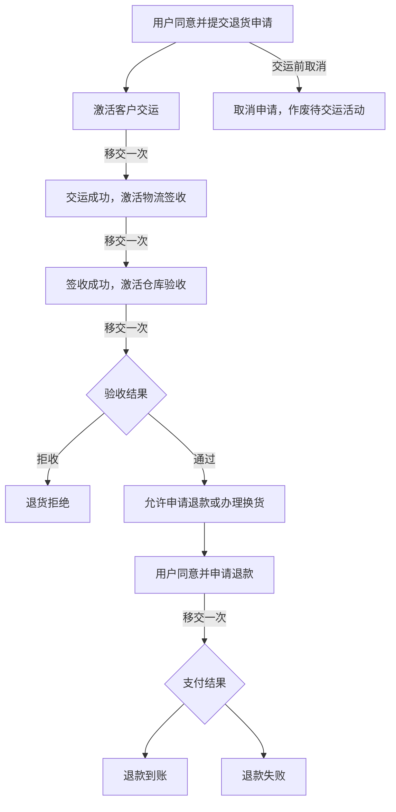

# 无模拟时间的业务流程（v2）

状态：已实现。新生成的履约世界默认采用 `lifecycle_schema.version=2`；已有 v1 世界继续使用原有时间调度。完整退货退款示例在 [examples/returns_workflow](../examples/returns_workflow/)，原有版本见 [v1 状态机](lifecycle-state-machine.md)。

## 运行方式

业务流程用有向图表达。一个成功的迁移可以激活多个后续活动，活动按条件分支、并行执行、汇合，也可以有受限的重试环。它不要求展开成一棵复制全部公共节点的树。



`api.yield_control()` 将控制权交给环境，一次最多尝试执行一个已激活且可运行的外部活动，随后回到 Agent 交互点。学生通过平台工具 `v3_yield` 使用它，HTTP 动作为 `{"type":"yield"}`。没有参数，不能指定私有节点或选择成功结果。平台工具支持与其他工具相同的随机别名与保留别名。

成功返回 `{"progressed":true,"status":"resumed"}`。没有可执行活动时返回 `{"progressed":false,"status":"blocked"}`；一次外部尝试被业务规则拒绝时返回 `{"progressed":false,"status":"resumed"}`，此时其他分支仍可能可执行。这些返回值不包含私有队列、情景参数或业务结果，Agent 应查询实际状态，再决定下一步。`blocked` 不是“全业务完成”；可能仍有等待输入的活动。重复移交不能凭空产生交运、签收或退款。

查询、聊天和同意确认不推进外部活动；最终回答不会自动清空队列。只有实际提交的动作才会激活后续工作。Agent 可以在交运前取消，或在验收通过后先询问用户，再请求退款。

## 世界、题目、运行实例

| 层级 | 定义内容 |
|---|---|
| 世界 | 状态、合法迁移、活动激活条件、角色、汇合条件、业务不变量、重试上限、可选参数与完成范围 |
| 题目 | 初始业务数据、用户诉求、合法历史、外部结果参数、完成范围、可选调度优先顺序 |
| Episode | 独立的数据库、待处理活动、已处理 ID、事件序列、幂等回执、同意令牌 |
| Verifier | 根据独立业务规则计算预期结果，并核对实际命令、移交、因果历史和最终状态 |

同一个世界供多个题目复用；每题不能重定义规则。每次运行和分叉拥有自己的状态，不需要每个 episode 独占 Docker。恢复根据动作记录重放，包含 `yield` 和记录下来的用户回复。新增调度器计入平台指纹，旧平台生成的 bundle 必须重新认证。

## 文件和字段

继续由 `request.json` 通过带 SHA-256 的侧文件引用：

- `lifecycle_schema.json`：`version=2`，世界流程图。
- `scenario.json`：`version=2`，题目情景。
- `lifecycle_contract.json`：**仍为 `version=1`**，这是独立测试格式的版本，与执行器版本分开。

`spec.write` 负责生成引用和哈希。`env.py` 保留工具签名与参考 Agent，受管写工具只格式化迁移后的回执；工具不能绕过迁移直接改状态。`verifier.py` 独立判断结果与因果关系。

### 状态和迁移

原有 `machines`、`tools`、`guard`、`effects`、`invariants` 继续有效。一张受管表由一个状态机管理，业务对象行预先存在，初始状态必须为 `initial`；不能通过 effects 设置 ID 或其他对象的状态字段。

迁移新增字段：

| 字段 | 语义 |
|---|---|
| `execution` | 默认为 `external`。只有 `actor=system` 可以设为 `internal`，在本次事务中自动完成 |
| `requires` | AND 汇合条件；每项含 `transition` 和 `entity` 表达式，要求对应对象已经成功完成该迁移 |
| `max_occurrences` | 可选，1–10000；同一迁移、同一对象的成功执行次数上限，历史也计入。相同幂等键的重试不重复计数 |

外部主体包括客户、物流、仓库、支付和默认的 system 活动。Agent 迁移仍通过带同意的业务工具执行，不能被活动队列冒充。内部活动适合系统核算、规则派生等即时动作，不能把物理交运声明为内部动作。

### 活动激活

```json
{
  "transition": "handover",
  "entity": {"path": "entity"},
  "args": {},
  "when": {"path": "params.will_ship"},
  "ready": true,
  "cancel_when": false
}
```

| 字段 | 求值时间与作用 |
|---|---|
| `when` | 父迁移执行后求值一次；假则不创建活动，用于情景分支 |
| `entity`、`args` | 激活时求值并固定；绑定后续工作的业务对象与参数 |
| `ready` | 每次调度重新判断；假则保留活动但不执行 |
| `cancel_when` | 每次调度重新判断；真则取消活动 |
| 目标迁移的 `from` | 当前状态不在允许集合内时，取消已失效活动 |
| 目标迁移的 `guard` | 实际执行时判断；拒绝会消费并取消该次尝试，不创建成功后继 |

`ready` 和 `cancel_when` 的上下文是**目标活动**的对象、参数和当前数据库；`when/entity/args` 使用父迁移的上下文。需要等待另一分支时，用 `requires` 或 `ready`；不要用会立即拒绝的 guard，也不要把尚未进入的状态设为活动唯一合法来源。

V2 不接受 `delay`、`at`、历史 `offset`。`scenario.dispatch_order` 可列出互不重复的外部迁移名作为优先顺序，未列出的活动排后；同优先级按激活序号、稳定活动 ID 排序。它不会绕过来源、依赖和就绪条件。

### 并行与汇合

换货可以同时激活“仓库验收”和“库存预留”，在同一个换货对象上汇合：

```json
{
  "machine": "exchange",
  "actor": "system",
  "execution": "internal",
  "from": ["pending"],
  "to": "approved",
  "requires": [
    {"transition": "inspect", "entity": {"path": "entity"}},
    {"transition": "reserve", "entity": {"path": "entity"}}
  ]
}
```

各分支可使用不同表，但关联 ID 必须来自真实业务关系。`requires` 核对指定迁移和对象，并把实际前驱的回执 ID 写入 `dependencies`。两条分支顺序可以互换，缺少其中任何一条都不能通过；R1 的验收不能替代 R2 的验收。

这些依赖是历史成功凭据，不是会被消费的令牌。库存是否仍有效、是否取消等当前条件要另用 guard/ready 检查。若一次业务重试必须重新验收、重新预留，应为新尝试使用独立的预分配业务对象 ID；不能指望旧依赖自动失效。

### 事务、预算与回放

一次工具写入或移交先在私有副本上执行。数据库变化、内部活动闭包、队列、日志和回执一起提交；内部异常、不变量错误或预算超限时整体回滚。外部业务拒绝属于正常取消，记录取消原因，不视为环境故障。

每次外部尝试后，调度器完成所有可运行的内部活动，并清除失效活动。`max_events` 默认 1000、最高 10000，统计整个 episode 已处理的活动，包括取消和历史；超限报环境错误，避免内部循环。成功命令的幂等重试只返回原回执，不激活新活动。

V2 日志以连续 `sequence` 表达因果顺序，包含 `transition`、`activated`、`handoff`、`event_cancelled`；迁移记录前后状态哈希、角色、对象和依赖。Snapshot 保存版本、规格哈希、固定日期、pending、processed、log、receipts 和 event_count。运行 trace 中兼容保留的 `time` 是固定日期，不是调度器时钟。

### 合法初始历史

```json
{
  "version": 2,
  "scope": "full",
  "parameters": {"will_ship": true, "inspection_pass": true, "payment_success": true},
  "history": [
    {"type": "command", "transition": "apply", "entity": "R1", "args": {}, "key": "past-return"},
    {"type": "yield"},
    {"type": "yield"}
  ]
}
```

从初始行重放后，这个退货实例已完成交运和签收，但未验收。历史 command 只能调用 Agent 迁移；外部迁移必须来自实际激活的活动，历史 yield 必须成功推进一次。历史属于可信题目输入，不是学生可调用的写状态接口。

刚申请退货的题目应使用空历史；用户开场确实描述过去已寄回的业务，才选用相应合法历史。`request_only` 完成申请即可停止，`full` 按规则继续至到账、拒收、失败，或告知当前阻塞状态。

## 日期与到期事件

`time.start` 保留为固定业务日期或参考值，`tick=0`。日期可用于判断“购买时距今是否超过退货期”等初始资格；它不会因调用工具、聊天或移交而增加。V2 调用 `wait` 会拒绝。

如果题目要考“过程中期限到期”，世界必须声明真正的到期业务事件及其激活条件、分支和后果；不能依据查库存次数偷偷使订单过期。框架不会从原来的 delay 自动推断这种业务语义。原有 v1 的历史、时长和事件需要按业务重新建模后才能迁移，不能仅修改 version。

## 生成和验收

世界作者、题目作者、代码作者、修复与 verifier 提示词均已接入 v2。独立契约的推进步骤使用 `{"yield":true,"checks":[...]}`；SOP 节点可用 `yield_before=true`，轨迹检查也重放 yield。Rubric 对话记录会显示移交结果。

门禁要求真实覆盖所有迁移、至少一个移交和预期业务拒绝。参考执行与独立 expected 比对后，再检查实际因果历史；即使答案和数据库正确，伪造前驱仍然不合格。示例 verifier 从真实工具命令和移交 trace 独立重建活动，核对日志、队列、处理 ID、回执与最终状态，不导入执行器。

验证包含：一移交一外部环节、只读/聊天不推进、未寄回阻塞、取消、验收和支付分支、并行汇合、跨对象隔离、就绪条件、内部事务回滚、重试预算、历史合法性、分叉恢复、别名工具、独立反例、HTTP 和 bundle 门禁。端到端退货退款示例可直接重建：

```sh
.venv/bin/python examples/returns_workflow/build_request.py
.venv/bin/pytest -q tests/env_factory/test_workflow.py tests/env_factory/test_lifecycle.py
```
